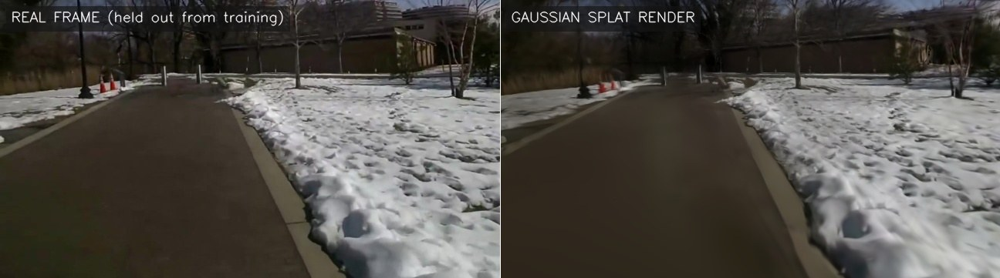
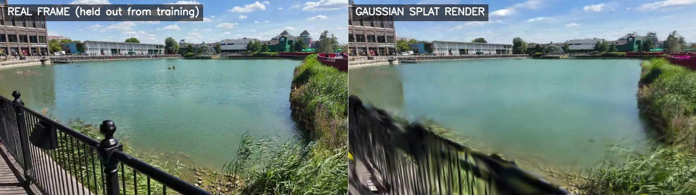
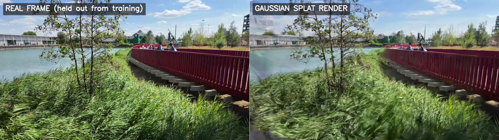
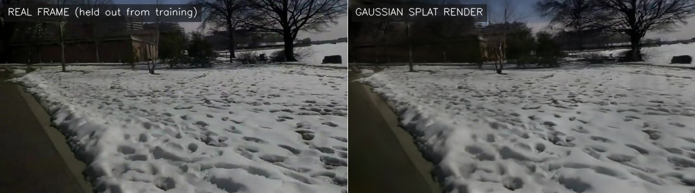
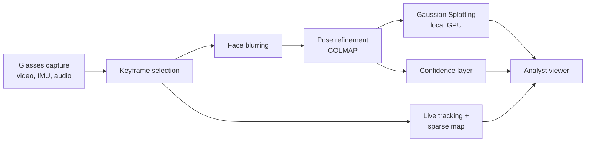

# xo-glasses-splat

**Smart-glasses footage to live 3D maps and Gaussian Splatting models, processed on worn and local hardware only.**

X-O Labs proof of concept for the HMGCC Co-Creation challenge *Smart glasses for mapping* (CH-2026-011).
It shows the pipeline from the proposal working end to end today:

- a **live path** that tracks the wearer and builds a sparse map frame by frame within a real-time budget;
- a **post-mission path** that refines poses and trains a photorealistic **Gaussian Splatting** model;
- **accuracy measured against ground truth**, not asserted;
- **privacy built in**, with faces blurred before anything is reconstructed;
- **no cloud services at any stage**.

**[Open the 3D viewer](https://launchpadlabsgh.github.io/xo-glasses-splat/)**: orbit the maps, switch layers, walk the camera route.



*Real Google Glass footage, Washington DC. Left: a frame the model never saw during training. Right: the
same viewpoint rendered from the Gaussian Splatting model, trained in about 2 minutes on a single RTX 5070.*

## Results

Three scenes, all processed end to end by this pipeline. Splat quality is measured on held-out frames:
every 8th frame is kept out of training and compared with the render from the same viewpoint.

| | Washington DC | London Docklands | Desk benchmark |
|---|---|---|---|
| Footage | **Real Google Glass**, 720p, 110 s | Handheld 4K walk, 92 s | Handheld camera, 640×480, 20 s |
| Keyframes kept | 283 of 440 | 155 of 277 | 220 of 407 |
| Keyframes placed in 3D | 95 (34%) | 104 (67%) | 219 (99.5%) |
| Reprojection error | 1.05 px | 1.17 px | 0.92 px |
| **Splat quality, held-out frames (PSNR / SSIM)** | **22.3 dB / 0.73** | **21.6 dB / 0.63** | **20.4 dB / 0.80** |
| Splat training (RTX 5070) | 131 s, 1.2 M Gaussians | 130 s, 1.0 M Gaussians | 140 s, 0.6 M Gaussians |
| Live path, time per frame (p50 / p95) | 9.4 / 15.3 ms | 13.1 / 17.9 ms | 7.3 / 16.0 ms |
| Live path, tracking lost and restarted | 10 times | 18 times | 2 times |
| Face detections blurred | 8 | 73 | 24 (false positives, no people) |
| **Ground-truth accuracy** | no ground truth | no ground truth | **3.1 cm over a 9.4 m path (0.33%)** |

<p>



</p>

### Accuracy against ground truth

The desk benchmark (TUM RGB-D `freiburg1_desk`) is a handheld camera with fast, jerky motion, a
reasonable stand-in for head-worn capture, and has motion-capture ground truth.

| Measure | Result |
|---|---|
| **Post-mission camera path error (ATE RMSE)** | **3.1 cm over a 9.4 m path (0.33%)** |
| Live path drift, longest tracked stretch | 11.4 cm over 2.8 m (4.1%) |
| Live frames within a 30 fps budget | 99.3% |
| Map points flagged low-confidence | 13% |

<p>


</p>

### What the outdoor scenes show

- **Real smart-glasses footage can be reconstructed today.** The DC scene is consumer Google Glass
  video, with no calibration, no motion-sensor data and heavy compression, and the held-out renders
  still match closely.
- **Only part of the DC walk was placed in 3D (95 of 283 keyframes).** The public clip was
  re-stabilised after upload, which warps the geometry between frames, and it includes fast head turns.
  This is the case for the proposal's approach: raw, unstabilised capture with timestamped
  motion-sensor data from the glasses.
- **The London map is sparse (2,666 points),** because open water, sky and reeds give few stable
  features. The splat model still renders the scene well from the cameras that were placed.
- **The live path loses tracking outdoors** (10 and 18 restarts). It is a camera-only CPU stand-in.
  Tracking that also uses the glasses' motion sensor is the first engineering task in the funded
  project.

## How it works



1. **Keyframe selection.** Drops motion-blurred frames and fast head turns (using IMU data when
   available), and keeps frames with enough parallax. Every dropped frame has a recorded reason.
2. **Face blurring.** Runs before reconstruction, so no identifiable face reaches a 3D model.
3. **Live path.** Frames are processed once, in capture order, and each is timed against the frame
   budget: a stand-in for tracking on the glasses' compute puck.
4. **Post-mission refinement.** COLMAP Structure-from-Motion, then Gaussian Splatting training with
   [gsplat](https://github.com/nerfstudio-project/gsplat) on a local NVIDIA GPU.
5. **Confidence.** Each map region is scored by how many viewpoints saw it and from how wide an angle.
   Analysts see what was observed properly and what is a guess.
6. **Audio events.** Loud acoustic events are pinned to where the wearer was. Speech is never transcribed.

Details: [Architecture](docs/ARCHITECTURE.md) · [Data flow and access](docs/DATA_FLOW.md) ·
[Privacy](docs/PRIVACY.md) · [Capture protocol](docs/CAPTURE_PROTOCOL.md) · [Roadmap to TRL 4](docs/ROADMAP.md)

## Honest limitations

- **No smart-glasses hardware yet.** Demo inputs are public footage, including real Google Glass video.
  The proposed XREAL Aura is confirmed at the project's Week 1 device gate.
- **The live path is a CPU proxy.** It is a monocular visual-odometry front end timed on an x86 CPU,
  not on the Aura's Snapdragon puck. It has no loss-of-tracking relocalisation and drifts, as the
  numbers above show. The funded project replaces it with visual-inertial odometry, where the IMU gives
  metric scale and copes with fast head turns.
- **Scale.** Monocular footage has no absolute scale. The benchmark is scaled by alignment to ground
  truth. For own footage, printed ArUco markers at measured positions give metric scale and an error
  figure ([capture protocol](docs/CAPTURE_PROTOCOL.md)).
- **Splat scores are below published benchmarks** (typically 25–30 dB on carefully shot photo sets).
  The inputs here are compressed, motion-blurred video, trained at half resolution for 7,000
  iterations, about 2 minutes each. Raw capture and longer training are the obvious next gains.
- **Privacy.** Face blurring is deliberately conservative and also fires on some face-like patterns.
  Number-plate blurring is not yet implemented.

## Run it

CPU stages (any Linux, macOS or WSL machine with Python 3.10+ and ffmpeg):

```bash
python3 -m venv .venv && . .venv/bin/activate
pip install -e ".[dev]"
bash scripts/fetch_demo_data.sh tum
xgs run data/raw/tum/rgbd_dataset_freiburg1_desk --run runs/tum-desk --device tum_fr1 --set ingest.fps=30
xgs report --run runs/tum-desk
```

Gaussian Splatting training (NVIDIA RTX GPU; tested setup is Windows 11 + WSL2 Ubuntu with an RTX 5070):

```bash
bash scripts/setup_wsl_gpu.sh
xgs train --run runs/tum-desk --device tum_fr1
xgs export --run runs/tum-desk --name tum-desk --device tum_fr1
```

All demo scenes end to end: `bash scripts/run_demo.sh`. To view locally:
`(cd docs && python3 -m http.server 8000)`, then open http://localhost:8000.

Every stage writes a `manifest.json` with its parameters, code hash, timings, metrics and library
versions. Re-runs skip unchanged stages, which keeps results reproducible.

## Licence

Shared for evaluation; see [LICENSE](LICENSE).
Third-party components are listed in [THIRD_PARTY_NOTICES.md](THIRD_PARTY_NOTICES.md), and demo data
attribution in [docs/DATA_SOURCES.md](docs/DATA_SOURCES.md).
