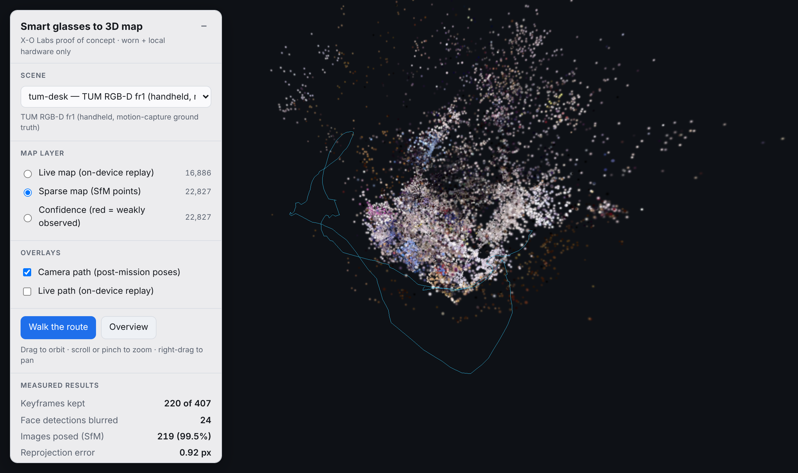
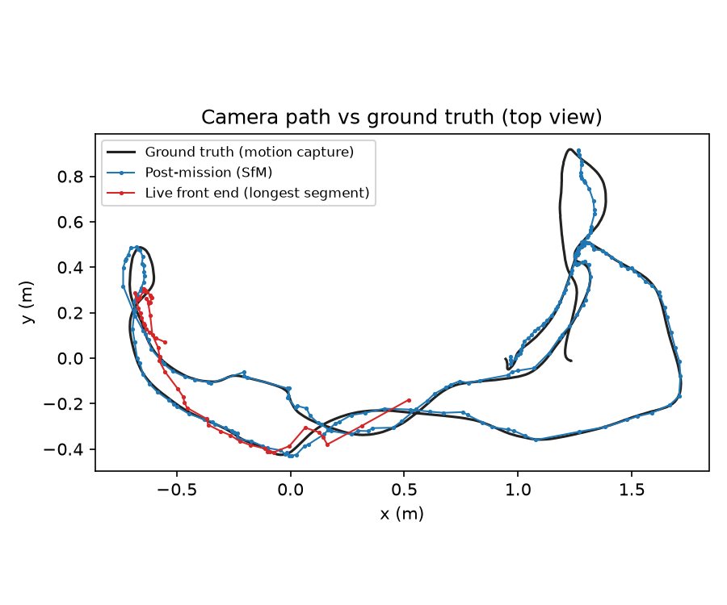
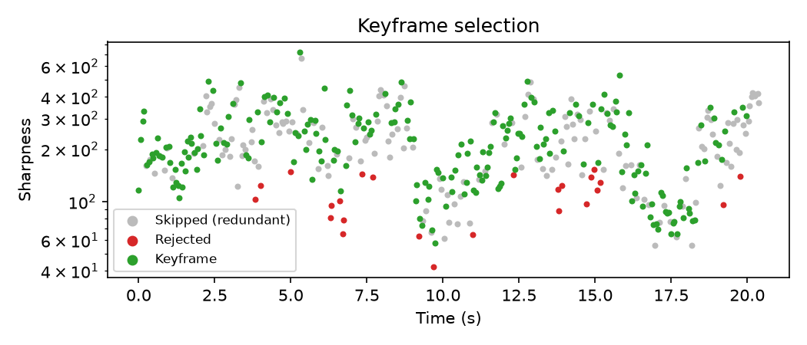
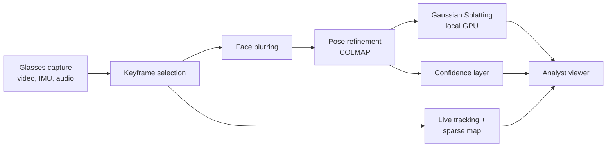

# xo-glasses-splat

**Smart-glasses footage to live 3D maps and Gaussian Splatting models, processed on worn and local hardware only.**

X-O Labs proof of concept for the HMGCC Co-Creation challenge *Smart glasses for mapping* (CH-2026-011).
It shows the pipeline from the proposal working end to end today:

- a **live path** that tracks the wearer and builds a sparse map frame by frame within a real-time budget;
- a **post-mission path** that refines poses and trains a photorealistic **Gaussian Splatting** model;
- **accuracy measured against ground truth**, not asserted;
- **privacy built in**, with faces blurred before anything is reconstructed;
- **no cloud services at any stage**.

**[Open the 3D viewer](https://launchpadlabsgh.github.io/xo-glasses-splat/)**: orbit the map, switch layers, walk the camera route.



## Measured results

Benchmark: **TUM RGB-D `freiburg1_desk`**, a handheld camera with fast, jerky motion (a reasonable
stand-in for head-worn capture), with motion-capture ground truth. 407 frames, 20 s, 640×480.

| Measure | Result |
|---|---|
| Keyframes kept (blur, motion and redundancy filtered) | 220 of 407 |
| Images posed after the mission | 219 of 220 (99.5%) |
| Mean reprojection error | 0.92 px |
| **Post-mission pose error vs ground truth (ATE RMSE)** | **3.5 cm over a 9.4 m path (0.37%)** |
| Live front end, time per frame (p50 / p95, CPU) | 11.1 / 29.0 ms |
| Live frames within a 30 fps budget | 97.1% |
| Live pose drift, longest tracked segment | 11.4 cm over 2.8 m (4.1%) |
| Map points flagged low-confidence | 13.1% |
| Gaussian Splatting PSNR on held-out views | *pending RTX run* |

<p>


</p>

## How it works



1. **Keyframe selection.** Drops motion-blurred frames and fast head turns (using IMU data when
   available), and keeps frames with enough parallax. Every dropped frame has a recorded reason.
2. **Face blurring.** Runs before reconstruction, so no identifiable face reaches a 3D model.
3. **Live path.** Frames are processed once, in capture order, and each is timed against the frame
   budget: a stand-in for tracking on the glasses' compute puck.
4. **Post-mission refinement.** COLMAP Structure-from-Motion, then Gaussian Splatting training with
   [gsplat](https://github.com/nerfstudio-project/gsplat) on a local NVIDIA GPU.
5. **Confidence.** Each map region is scored by how many viewpoints saw it and from how wide an angle.
   Analysts see what was observed properly and what is a guess.
6. **Audio events.** Loud acoustic events are pinned to where the wearer was. Speech is never transcribed.

Details: [Architecture](docs/ARCHITECTURE.md) · [Data flow and access](docs/DATA_FLOW.md) ·
[Privacy](docs/PRIVACY.md) · [Capture protocol](docs/CAPTURE_PROTOCOL.md) · [Roadmap to TRL 4](docs/ROADMAP.md)

## Honest limitations

- **No smart-glasses hardware yet.** Demo inputs are public footage, including real Google Glass video.
  The proposed XREAL Aura is confirmed at the project's Week 1 device gate.
- **The live path is a CPU proxy.** It is a monocular visual-odometry front end timed on an x86 CPU,
  not on the Aura's Snapdragon puck. It has no loss-of-tracking relocalisation and drifts, as the
  numbers above show. The funded project replaces it with visual-inertial odometry, where the IMU gives
  metric scale and copes with fast head turns.
- **Scale.** Monocular footage has no absolute scale. The benchmark is scaled by alignment to ground
  truth. For own footage, printed ArUco markers at measured positions give metric scale and an error
  figure ([capture protocol](docs/CAPTURE_PROTOCOL.md)).
- **Privacy.** Face blurring is deliberately conservative and also fires on some face-like patterns.
  Number-plate blurring is not yet implemented.

## Run it

CPU stages (any Linux, macOS or WSL machine with Python 3.10+ and ffmpeg):

```bash
python3 -m venv .venv && . .venv/bin/activate
pip install -e ".[dev]"
bash scripts/fetch_demo_data.sh tum
xgs run data/raw/tum/rgbd_dataset_freiburg1_desk --run runs/tum-desk --device tum_fr1 --set ingest.fps=30
xgs report --run runs/tum-desk
```

Gaussian Splatting training (NVIDIA RTX GPU; tested setup is Windows 11 + WSL2 Ubuntu with an RTX 5070):

```bash
bash scripts/setup_wsl_gpu.sh
xgs train --run runs/tum-desk --device tum_fr1
xgs export --run runs/tum-desk --name tum-desk --device tum_fr1
```

### Windows: running from another drive

WSL keeps its Ubuntu install, and everything in it, on C: by default. This project needs about 15 GB
(CUDA toolkit, PyTorch, footage and results). To keep it all on another drive (it must be an internal
NTFS drive, and the target folder must not be compressed), move Ubuntu there before running setup.
In PowerShell:

```powershell
wsl --update
wsl --list --verbose          # note your distribution's name, e.g. Ubuntu
wsl --shutdown
wsl --manage Ubuntu --move F:\WSL\Ubuntu
```

On older WSL versions without `--manage --move`, export and re-import instead. Check that the `.tar`
file exists and is several GB before running `--unregister`: that step deletes the C: copy.

```powershell
mkdir F:\WSL
wsl --export Ubuntu F:\WSL\ubuntu.tar
wsl --unregister Ubuntu
wsl --import Ubuntu F:\WSL\Ubuntu F:\WSL\ubuntu.tar
wsl -d Ubuntu -u root -- bash -c "printf '[user]\ndefault=YOUR_LINUX_USERNAME\n' >> /etc/wsl.conf"
wsl --shutdown
```

**If the move seems to hang:** it is usually still copying. The `.vhdx` file appears on F: straight
away and fills up as the copy runs. The C: original is deleted only once the copy succeeds, so nothing
is lost while you wait. In a second PowerShell window:

```powershell
(Get-Item F:\WSL\Ubuntu\ext4.vhdx).Length / 1GB      # run a few times: still growing = still copying
Get-ChildItem HKCU:\Software\Microsoft\Windows\CurrentVersion\Lxss | Get-ItemProperty | Select DistributionName, BasePath
```

The second command shows where WSL currently keeps the distribution; the copy is done when F: reaches
the size of the `ext4.vhdx` in that folder. Close Docker Desktop, VS Code WSL windows and Ubuntu
terminals, which hold the disk open. Add `F:\WSL` as a Windows Security exclusion if antivirus slows
the copy. Press Ctrl+C only if the F: size has not changed for 15 minutes and F: is idle. Then, if
`BasePath` still points to C:, delete the partial F: copy and use export/import instead. Never delete
either `.vhdx` until `wsl -d Ubuntu` starts and your files are there.

Without Ubuntu installed yet, install it straight onto F: with
`wsl --install -d Ubuntu-24.04 --location F:\WSL\Ubuntu`.

Keep the repository inside Ubuntu (e.g. `~/xo-glasses-splat`), not under `/mnt/f`. Windows-drive
access from WSL is many times slower, and the Ubuntu install itself is now on F:.

All demo scenes end to end: `bash scripts/run_demo.sh`. To view locally:
`(cd docs && python3 -m http.server 8000)`, then open http://localhost:8000.

Every stage writes a `manifest.json` with its parameters, code hash, timings, metrics and library
versions. Re-runs skip unchanged stages, which keeps results reproducible.

## Licence

Copyright © 2026 X-O Labs Ltd. All rights reserved. Shared for evaluation; see [LICENSE](LICENSE).
Third-party components are listed in [THIRD_PARTY_NOTICES.md](THIRD_PARTY_NOTICES.md), and demo data
attribution in [docs/DATA_SOURCES.md](docs/DATA_SOURCES.md).
