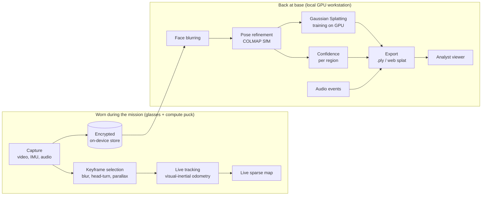

# Architecture

The pipeline follows the operating model in the X-O Labs proposal: a **live path** that runs on the
worn device during the mission, and a **base path** that refines the map on local hardware afterwards.
Nothing is sent to a cloud service at any stage.

## Stage by stage

| Stage | Module | What it does | Runs on |
|---|---|---|---|
| ingest | `xgs.io` | Frames (and audio) from video, image folders or benchmark sequences; timestamps kept | CPU |
| select | `xgs.select.keyframes` | Rejects motion-blurred frames and fast head turns (IMU gyro, or optical flow without IMU); keeps frames with enough parallax; records a reason for every dropped frame | CPU |
| privacy | `xgs.privacy.faces` | Detects and irreversibly blurs faces **before** any reconstruction | CPU |
| sfm | `xgs.sfm.colmap` | SIFT features, sequential matching, incremental mapping (COLMAP via pycolmap); undistorts to a pinhole camera for training | CPU |
| confidence | `xgs.confidence` | Scores every 3D point by number of views and triangulation angle, so weakly observed regions are flagged, not presented as fact | CPU |
| live | `xgs.live.replay` | Replays frames in capture order through a lightweight monocular VO front end, timing each frame against the frame budget | CPU (proxy for the puck) |
| audio | `xgs.audio.events` | Detects loud acoustic events and pins them to where the wearer was; no speech transcription | CPU |
| splat | `xgs.splat.train` | Trains a Gaussian Splatting model with gsplat; held-out views give PSNR/SSIM | NVIDIA GPU |
| export | `xgs.report.export` | Aligns all layers into one viewer frame and writes web assets | CPU |

## Mapping to the proposed hardware

| Proof of concept | Funded project (proposal) |
|---|---|
| Video files and public footage | XREAL Aura RGB camera + IMU via Android XR (confirmed at the Week 1 device gate) |
| Live path replayed on an x86 CPU | Live path on the Aura's body-worn Snapdragon compute puck |
| Monocular VO front end (no scale) | Visual-inertial odometry: IMU gives metric scale and handles fast head turns |
| COLMAP on CPU, splats on an RTX 5070 | Same software on local hardware (e.g. NVIDIA DGX Spark); no cloud |
| Self-calibration from footage | Factory or measured calibration from the device SDK |

## Reproducibility

Every stage writes a `manifest.json`: parameters, a hash of the stage's source code, upstream
fingerprints, timings, metrics and library versions. Re-running skips stages whose inputs, parameters
and code are unchanged, and any change propagates downstream. `xgs report` gathers the manifests into
`results.md` and `results.json`.

## Third-party components

All runtime dependencies are permissively licensed (see `THIRD_PARTY_NOTICES.md`). In particular, the
splat trainer is X-O Labs' own code built on **gsplat (Apache-2.0)**. It does not use the original
Inria 3DGS implementation, which is licensed for non-commercial research only.
